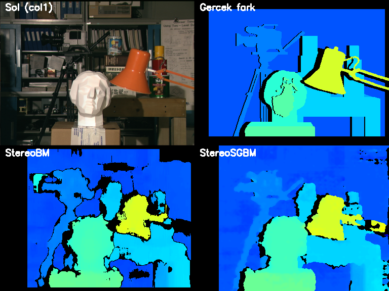
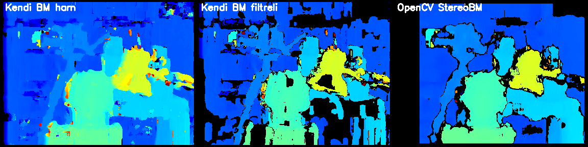
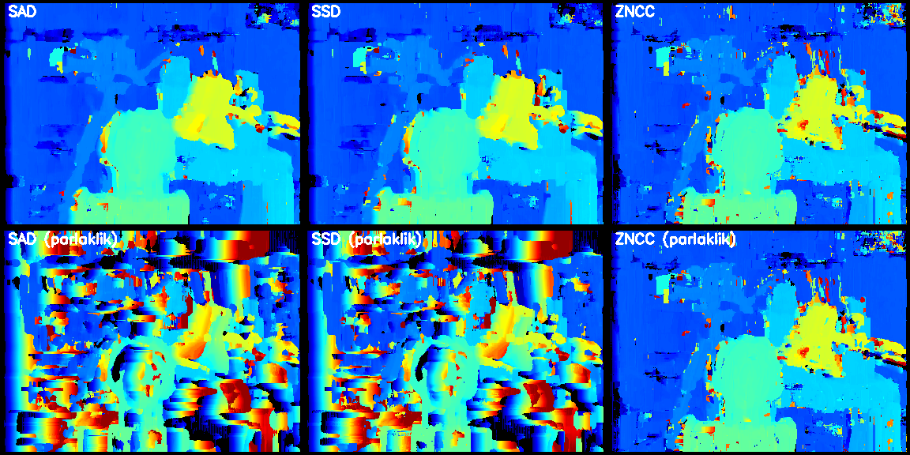
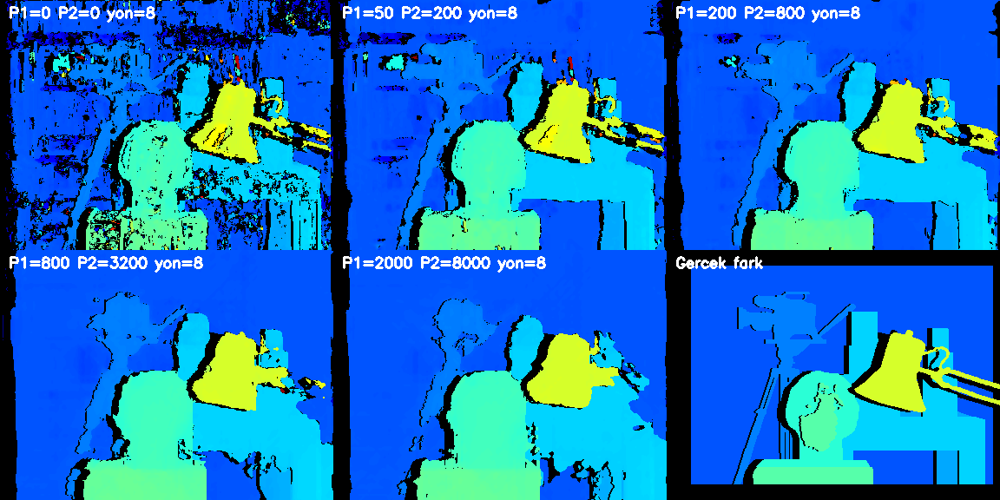
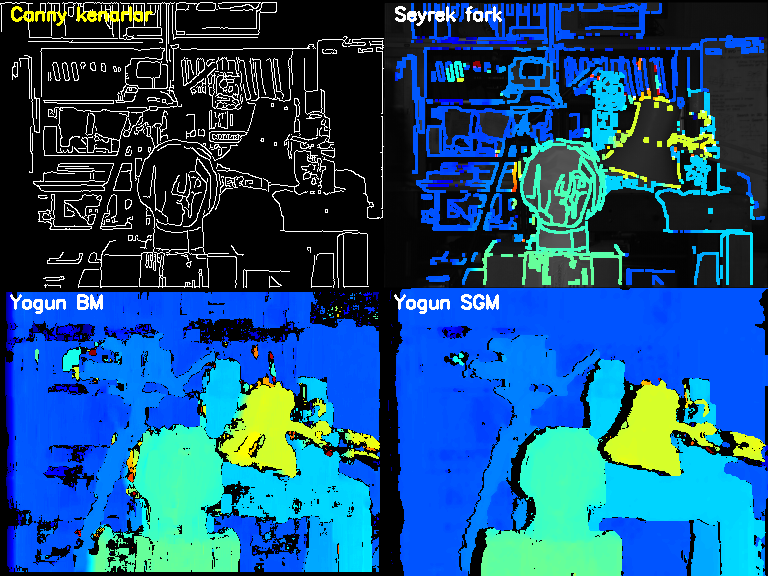

# Hafta 10 - Stereo Eşleştirme

Veri: Middlebury 2001 Tsukuba (`tsukuba.zip`). 1. ve 3. resim kullanıldı:

| Dosya | Rol |
|---|---|
| `veri/scene1.row3.col1.ppm` | Sol görüntü (referans) |
| `veri/scene1.row3.col3.ppm` | Sağ görüntü |
| `veri/truedisp.row3.col3.pgm` | Gerçek fark haritası (doğruluk ölçümü için) |

Gerçek fark haritası 16 ile ölçeklidir ve komşu kameralar için verilmiştir. Col1 ile col3 arasındaki
baz uzunluğu iki kat olduğundan gerçek fark `değer / 16 * 2` olur (yaklaşık 10-28 piksel). Harita col3'e
göre verildiği için sol görüntüye taşındı (`gtSolaTasi`). Bütün yöntemler aynı ölçütle karşılaştırıldı:

- **Kötü piksel (%)**: gerçek farktan 2 pikselden fazla sapan geçerli piksellerin oranı
- **Ort. hata**: ortalama mutlak fark hatası (piksel)
- **Kapsama (%)**: gerçek değeri bilinen piksellerden kaçına fark değeri üretildiği

## Derleme ve Çalıştırma

```bash
cd Hafta10
for g in gorev_1 gorev_2 gorev_3 gorev_4 ev_odevi; do
  g++ -std=c++17 -O2 $g/main.cpp -o $g/$g $(pkg-config --cflags --libs opencv4)
done

./gorev_1/gorev_1                       # varsayılan: veri/ okunur, sonuclar/ klasörüne yazılır
./gorev_1/gorev_1 veri sonuclar --goster
```

Ortak kod `ortak/stereo_ortak.hpp` içindedir: veri okuma, değerlendirme, SAD/SSD/ZNCC, blok eşleştirme ve SGM.
Süreler 2 çekirdekli bir makinede ölçülmüştür ve çalıştırmadan çalıştırmaya yaklaşık %20 değişir.
Doğruluk değerleri her çalıştırmada aynıdır.

---

## Görev 1 - StereoBM ve StereoSGBM

`gorev_1/main.cpp`

| Yöntem | Süre | Kötü piksel | Ort. hata | Kapsama |
|---|---|---|---|---|
| StereoBM (15x15) | 4.6 ms | 4.58 % | 0.67 | 84.1 % |
| StereoSGBM (5x5, P1=200, P2=800) | 15.1 ms | 3.46 % | 0.59 | 97.3 % |



### Renklerin anlamı

Harita `COLORMAP_JET` ile renklendirildi (0 ile 48 piksel arası):

- **Kırmızı / sarı**: büyük fark, yani kameraya **yakın** nesneler. Örnek: lamba (yaklaşık 28 px).
- **Yeşil / açık mavi**: orta uzaklık. Örnek: heykel başı ve masa.
- **Koyu mavi**: küçük fark, yani **uzak** nesneler. Örnek: arkadaki raf ve duvar (yaklaşık 10 px).
- **Siyah**: geçersiz bölge. Eşleşme bulunamadı ya da güvenilir değil. Bunun nedenleri:
  - Örtülme (occlusion): Nesne kenarının bir yanı sadece bir kamerada görünür. Lambanın ve heykelin solunda siyah şerit vardır.
  - Dokusuz alanlar.
  - Sol kenar şeridi: Burada sağ görüntüde aranacak piksel yoktur.

StereoBM büyük pencere kullandığı için nesne sınırlarını şişirir ve dokusuz yerlerde boşluk bırakır.
StereoSGBM, komşu pikseller arasında yumuşaklık şartı koyduğu için daha dolu ve daha düzgün bir harita verir.

### Gerçek bir derinlik ölçümü sağlıyor mu?

**Hayır, doğrudan sağlamaz.** Fark haritası sadece **göreceli** (sıralı) derinlik bilgisi verir.
Metrik derinlik için `Z = f · B / d` formülü gerekir:

- Odak uzaklığı `f` ve kameralar arası baz uzunluğu `B` kalibrasyondan bilinmelidir. Tsukuba verisinde bu bilgiler yoktur.
- İlişki ters orantılıdır ve doğrusal değildir. Uzak nesnelerde 1 piksellik fark hatası çok büyük bir derinlik hatasına dönüşür.
- Görüntüler rektifiye (epipolar çizgiler yatay) olmalıdır. Kalibrasyon hataları doğrudan derinliğe yansır.
- Siyah bölgelerde hiç derinlik yoktur.

Kısacası, "lamba heykelden yakındır" denebilir. Ama "lamba 1.2 metredir" demek için kalibrasyon gerekir.

---

## Görev 2 - Kendi Blok Eşleştirme Fonksiyonu

`gorev_2/main.cpp` ve `ortak/stereo_ortak.hpp` (`blokEslestir`, `pikselEslestir`)

StereoBM kullanılmadı. Her sol piksel için şu adımlar uygulanır:

1. Etrafında `(2r+1)x(2r+1)` boyutunda bir pencere alınır.
2. Sağ görüntüde aynı satırda `x-d` konumundaki pencere ile karşılaştırılır (`d = 0..47`).
3. En düşük maliyetli `d` seçilir (Winner-Takes-All).
4. **Benzersizlik testi**: İkinci en iyi aday en iyiye çok yakınsa piksel geçersiz sayılır.
5. **Doku eşiği**: Yatay gradyanı zayıf olan (dokusuz) pikseller atlanır.
6. **Alt piksel**: Parabol uydurma ile kesirli fark hesaplanır.

Satırlar `cv::parallel_for_` ile paralel işlenir.

| Yöntem | Süre | Kötü piksel | Ort. hata | Kapsama |
|---|---|---|---|---|
| Kendi BM 9x9 (sadece WTA) | 183 ms | 13.47 % | 1.33 | 99.2 % |
| Kendi BM 9x9 (+benzersizlik, doku) | 140 ms | 7.55 % | 0.92 | 73.0 % |
| Kendi BM 15x15 (+benzersizlik, doku) | 462 ms | 7.82 % | 0.87 | 78.0 % |
| OpenCV StereoBM 15x15 | 4 ms | 5.04 % | 0.75 | 84.9 % |



Filtreler hatayı yarıya indirir, ama kapsamayı düşürür. OpenCV ön filtreleme (Sobel / normalizasyon),
kayan pencere toplamları ve SIMD kullandığı için çok daha hızlıdır. Bizim kodumuz her pencereyi baştan toplar.

---

## Görev 3 - SAD, SSD ve ZNCC (Fonksiyon Pointer)

`gorev_3/main.cpp` ve `ortak/stereo_ortak.hpp`

Üç ölçü de **aynı imzaya** sahiptir ve fonksiyon pointer ile çağrılır:

```cpp
typedef float (*BenzerlikFonk)(const cv::Mat& sol, const cv::Mat& sag, int x, int y, int d, int r);

float sad (const cv::Mat& sol, const cv::Mat& sag, int x, int y, int d, int r);
float ssd (const cv::Mat& sol, const cv::Mat& sag, int x, int y, int d, int r);
float zncc(const cv::Mat& sol, const cv::Mat& sag, int x, int y, int d, int r);

std::vector<Yontem> yontemler = {{"SAD", &st::sad}, {"SSD", &st::ssd}, {"ZNCC", &st::zncc}};
cv::Mat d = st::blokEslestir(v.sol, v.sag, y.fonk, ayar);
```

ZNCC bir benzerlik ölçüsüdür (1 en iyi). Üçünün de "küçük daha iyi" olması için `1 - ZNCC` döndürülür.

- SAD = Σ|I₁ − I₂|
- SSD = Σ(I₁ − I₂)²
- ZNCC = Σ(I₁ − μ₁)(I₂ − μ₂) / (σ₁ σ₂)

### Ölçüm sonuçları (9x9 pencere)

| Ölçü | Süre | Kötü piksel (normal) | Kötü piksel (sağ görüntü `0.7·I + 40`) |
|---|---|---|---|
| SAD | 120 ms | **13.47 %** | 65.29 % |
| SSD | 199 ms | 15.37 % | 58.67 % |
| ZNCC | 307 ms | 15.82 % | **16.18 %** |

| Pencere | SAD | SSD | ZNCC |
|---|---|---|---|
| 3x3 | 28.47 % | 28.45 % | 48.35 % |
| 5x5 | 18.51 % | 19.35 % | 27.23 % |
| 9x9 | 13.47 % | 15.37 % | 15.82 % |
| 15x15 | 12.10 % | 15.21 % | 13.83 % |



Üst satır normal çifti, alt satır parlaklığı değiştirilmiş çifti gösterir.

### Avantaj / dezavantaj tablosu

| | SAD | SSD | ZNCC |
|---|---|---|---|
| **Hesap maliyeti** | En düşük (sadece çıkarma ve mutlak değer) | Düşük (çarpma eklenir) | En yüksek (ortalama, varyans, karekök) |
| **Gürültüye / aykırı değere duyarlılık** | Daha dayanıklı (hata doğrusal büyür) | Hassas (hatanın karesi, aykırı pikseller baskın olur) | Orta |
| **Parlaklık / kontrast farkı** | Çok hassas (testte %13'ten %65'e) | Çok hassas (testte %15'ten %59'a) | **Dayanıklı** (ortalama çıkarılır, varyansa bölünür; %16'da kaldı) |
| **Dokusuz bölgeler** | Yanlış ama düşük maliyetli eşleşme verir | SAD ile aynı | Varyans 0 olunca tanımsızdır (kodda geçersiz sayılır) |
| **Küçük pencere** | İyi | İyi | Kötü (az pikselle istatistik güvenilmez, 3x3'te %48) |
| **Donanım / gerçek zaman** | En uygun (FPGA, SIMD) | Uygun | Daha zor |
| **Ne zaman seçilmeli** | Kameralar aynı ayarda ve hız önemliyse | Gauss gürültüsü varsa ve kuramsal olarak en uygunsa | Kameraların pozlama, kazanç veya aydınlatması farklıysa |

---

## Görev 4 - SGM (Semi-Global Matching) Uygulaması

`gorev_4/main.cpp` ve `ortak/stereo_ortak.hpp` (`sgm`)

Adımlar:

1. **Maliyet hacmi** `C(p, d)`: her `d` için 5x5 pencerede SAD hesaplanır (`H x W x 48`).
2. **Yol boyunca toplama**: 8 yönün (yatay, dikey, çapraz) her birinde şu formül uygulanır:

   ```
   L_r(p,d) = C(p,d) + min( L_r(p−r, d),
                            L_r(p−r, d−1) + P1,
                            L_r(p−r, d+1) + P1,
                            min_k L_r(p−r, k) + P2 )  −  min_k L_r(p−r, k)
   ```
3. **Toplam** `S(p,d) = Σ_r L_r(p,d)` hesaplanır. Her pikselde en küçük `S` değerini veren `d` seçilir. Ardından parabol ile alt piksel değeri bulunur.
4. **Son işlemler**: 3x3 medyan filtre uygulanır. Sağ fark haritası aynı `S` hacminden çıkarılır ve **sol-sağ tutarlılık kontrolü** yapılır. Fark 1 pikselden büyükse piksel geçersiz sayılır.

| Ayar | Süre | Kötü piksel | Ort. hata | Kapsama |
|---|---|---|---|---|
| P1=0, P2=0 (yumuşaklık yok) | 216 ms | 9.03 % | 0.94 | 78.8 % |
| P1=50, P2=200 | 177 ms | 4.01 % | 0.57 | 94.4 % |
| **P1=200, P2=800** | 179 ms | **3.05 %** | **0.49** | 96.3 % |
| P1=800, P2=3200 | 178 ms | 4.25 % | 0.56 | 96.4 % |
| P1=2000, P2=8000 | 180 ms | 7.03 % | 0.79 | 95.8 % |
| P1=200, P2=800 (4 yön) | 138 ms | 3.30 % | 0.51 | 95.9 % |
| OpenCV StereoSGBM | 11 ms | 3.63 % | 0.60 | 97.7 % |



### Smoothness (yumuşak geçiş) parametresi ne işe yarar?

Blok eşleştirme her pikseli **tek başına** değerlendirir. SGM ise enerji fonksiyonunu en aza indirir:

```
E(D) = Σ_p C(p, D_p)  +  Σ_{q∈N(p)} P1·[|D_p − D_q| = 1]  +  Σ_{q∈N(p)} P2·[|D_p − D_q| > 1]
```

İkinci ve üçüncü terimler **yumuşaklık (smoothness)** terimleridir. Komşu pikseller arasındaki fark
değişimini cezalandırırlar:

- **P1 (küçük ceza)**: Komşular arasında ±1 piksellik değişimi cezalandırır. Eğimli ve kavisli yüzeylerin (masa, heykel yüzü) düzgün ve kademeli değişmesini sağlar.
- **P2 (büyük ceza)**: Daha büyük sıçramaları cezalandırır. Gürültüden doğan rastgele sıçramaları bastırır. Gerçek derinlik süreksizliklerinde (nesne sınırları) ise maliyet farkı cezadan büyük olursa sıçramaya izin verir. Her zaman `P2 ≥ P1` olmalıdır.

Deney sonuçları beklenen **U eğrisini** verir:

- **Ceza yok (P1=P2=0)**: Sonuç yerel 5x5 SAD ile aynıdır. Harita gürültülüdür, hata %9'dur.
- **Uygun ceza (P1=200, P2=800)**: Gürültü kaybolur, nesne sınırları korunur. Hata %3'e düşer.
- **Aşırı ceza (P1=2000, P2=8000)**: Harita fazla düzleşir. İnce yapılar (lambanın kolu, tripod ayağı) kaybolur ve sınırlar kayar. Hata tekrar %7'ye çıkar.

Yön sayısının 8'den 4'e inmesi süreyi yaklaşık %25 azaltır, ama çapraz yönlerdeki bilgi kaybolduğu için doğruluk biraz düşer.

---

## Ev Ödevi - Seyrek (Sparse) ve Yoğun (Dense) Stereo

`ev_odevi/main.cpp`

1. Sol görüntüde **Canny** (50/150) ile kenarlar bulunur. Kenarlar görüntünün %11'idir (12 144 piksel).
2. Fark **sadece kenar piksellerinde** hesaplanır (SAD 9x9, benzersizlik testi). Rektifiye çiftte arama aynı satır boyunca yapılır.
3. İkinci bir seçenekte sadece **dikey bileşeni olan kenarlar** kullanılır (`|Gx| > 0.5·|Gy|`). Yatay kenarlar epipolar çizgiye paralel olduğu için belirsizdir.

### Tüm görüntü üzerinde

| Yöntem | Süre | Kötü piksel | Ort. hata | Kapsama (yoğunluk) |
|---|---|---|---|---|
| Seyrek: Canny + SAD 9x9 | **17 ms** | 9.08 % | 1.08 | 10.1 % |
| Seyrek: dikey kenar + SAD 9x9 | **11 ms** | 7.38 % | 1.13 | 6.4 % |
| Yoğun: kendi BM SAD 9x9 | 183 ms | 7.96 % | 0.90 | 86.6 % |
| Yoğun: kendi SGM | 216 ms | 3.05 % | 0.49 | 96.3 % |
| Yoğun: OpenCV StereoBM | 3.5 ms | 5.04 % | 0.75 | 84.9 % |
| Yoğun: OpenCV StereoSGBM | 14.5 ms | 3.63 % | 0.60 | 97.7 % |

### Sadece kenar piksellerinde (adil doğruluk kıyası)

| Yöntem | Kötü piksel | Ort. hata | Kapsama |
|---|---|---|---|
| Seyrek: Canny + SAD 9x9 | 9.08 % | 1.08 | 88.8 % |
| Yoğun: kendi BM SAD 9x9 | 9.08 % | 1.08 | 88.8 % |
| Yoğun: kendi SGM | 4.09 % | 0.63 | 95.3 % |
| Yoğun: OpenCV StereoBM | 5.17 % | 0.76 | 84.2 % |
| Yoğun: OpenCV StereoSGBM | 5.06 % | 0.72 | 98.0 % |



### Yorum

**Hız:**
- Seyrek yöntem, aynı eşleştirme koduyla yoğun yöntemden yaklaşık **7-10 kat hızlıdır** (17-22 ms ve 160-183 ms).
- Hız kazancı, işlenen piksel oranıyla doğru orantılıdır (%11). Canny'nin kendisi yaklaşık 1 ms sürer.
- Sadece dikey kenarlar kullanılınca süre 11 ms'ye iner.

**Doğruluk:**
- Kenar piksellerinde seyrek ve yoğun BM birebir aynı sonucu verir, çünkü aynı fonksiyon kullanılır.
- Kenarlar dokulu olduğu için eşleşme güvenilirdir. Ancak hepsi güvenilir değildir:
  - Yatay kenarlarda epipolar çizgi boyunca belirsizlik vardır.
  - Nesne sınırlarındaki kenarlarda örtülme vardır.
- Dikey kenarları seçmek tüm görüntüdeki hatayı %9.1'den %7.4'e düşürür.
- Kenar piksellerinde bile yoğun **SGM daha doğrudur** (%4.1). Sebebi, komşu bölgelerden gelen yumuşaklık bilgisini kullanmasıdır.

**Yoğunluk:**
- Seyrek yöntem görüntünün sadece %6-10'u için derinlik verir. Yüzeylerin içi boş kalır.
- Engel algılama, 3B yeniden oluşturma veya yüzey çıkarma için yoğun harita gerekir. Seyrek sonuç ancak enterpolasyon ile doldurulabilir.

**Sonuç:** Seyrek stereo, gerçek zamanlı ve sınırlı donanımlı sistemler için uygundur (görsel odometri,
özellik tabanlı SLAM). Bu sistemlerde az sayıda ama güvenilir nokta yeterlidir. Tam sahne derinliği
gerektiğinde yoğun yöntemler, özellikle SGM, tercih edilmelidir. OpenCV'nin optimize SGBM'i 14 ms ile
hem hızlı hem doğrudur. Bu nedenle pratikte seyrek yaklaşımın hız avantajı, ancak eşleştirme kodu
optimize edilmemişse veya çözünürlük çok yüksekse belirgin olur.
